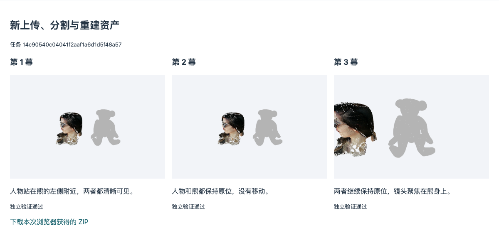

# FYP：图片重建与三维故事板

从照片中选择主体，生成三维点云，再用这些资产和一段故事生成三幕分镜、旁白及验证结果。

第一次运行请看 [详细代码执行说明书](docs/execution-guide-zh.md)：按 Mac/HPC/Slurm 区分命令，包含网页启动、主体选择、三种重建、故事与编辑 CLI、P8 评估、下载和故障排查。

当前已完成 P0–P7：SAM2 主体选择、三种可切换重建方法、资产管理、空间布局、故事理解、网页集成及局部修改版本保持。



上图来自实际 HPC 运行：新上传熊图 → SAM2 分割 → Hunyuan3D-2mini 重建 → DeepSeek 故事理解 → 三幕分镜。熊为灰色纯几何；人物仍有缺面。当前是静态刚体分镜，资产朝向仍待人工确认。

## 1. 快速查看效果：不需要 GPU

建议使用 Python 3.11。在项目根目录执行：

```bash
git clone https://github.com/sstgp-sgl/FYP.git
cd FYP
python3 -m venv .venv
source .venv/bin/activate
python -m pip install -r requirements-storyboard.txt

python scripts/storyboard.py demo --out outputs/quick-demo
python scripts/storyboard.py validate --run outputs/quick-demo
python -m http.server 8000 --bind 127.0.0.1
```

打开 **http://127.0.0.1:8000/outputs/quick-demo/storyboard.html**，可查看场景图片、点云和验证结果。这是合成方块的 CPU 演示，用来验证安装；不调用模型，也不代表真实重建质量。再次运行时换一个新的 `--out` 目录。

## 2. 在当前 HPC 上查看完整网页

需要已连接校园 VPN，且 Mac 已能执行 `ssh xjtlu`。目前工作区在服务器 **`~/work/code/FYP`**；模型、环境和历史运行保存在 `~/work`，不在 GitHub 中。

在 HPC 登录节点提交已有 P6 启动脚本：

```bash
ssh xjtlu
cd ~/work/code/FYP
sbatch --output="$HOME/work/runs/p6/20261122-web-01/server-%j.log" \
  "$HOME/work/runs/p6/20261122-web-01/serve.sbatch"
squeue -u "$USER" -o '%.18i %.10T %.20N'
```

等任务显示 `RUNNING`，记下分配节点。**同一份 P6 状态目录只启动一个服务**；已有服务运行时直接复用。该脚本会先执行测试，再启动网页；GPU 配额不足时需要排队。通过日志确认服务已启动：

```bash
tail -f ~/work/runs/p6/20261122-web-01/server-你的任务ID.log
```

在 **Mac 另开终端**，将 `实际节点` 替换为上一步的节点名称：

```bash
ssh -N -L 17862:实际节点:17862 -o ControlPath=none xjtlu
```

保持终端开启，浏览器打开 **http://127.0.0.1:17862/**。

网页操作：

1. 勾选已有的“人物”和“熊”；也可以上传图片，点击主体、预览分割、确认名称和掩码，然后选择重建方法。
2. 输入三幕故事，例如：“第一幕人物在熊的左侧附近；第二幕两者保持原位；第三幕镜头关注熊。”
3. 点击生成，等待阶段状态、三幕图片和旁白出现。
4. 下载 ZIP；刷新后可以从历史任务继续查看。
5. 在“修改故事板”中只改指定幕的旁白、镜头或已有关系/距离，或输入一句修改要求。其他幕默认锁定，新版本失败不覆盖旧版；可以切换版本。跨幕依赖冲突时，明确解除相关锁定并指定调整方式，或返回原故事放宽事件要求后重新生成。

完整网页需要已有资产、SAM2、所选重建模型和 DeepSeek 密钥。当前 HPC 已配置，密钥保存在仓库外。**新机器仅 clone 代码不能直接运行这些模型**；安装与配置方法见 [网页运行说明](docs/storyboard-web.md)。HPC 推理只在 Slurm 计算节点运行。

## 3. 选择重建方法

支持 `vggt`（Zero123++ → VGGT）、`triposr` 和 `hunyuan`（Hunyuan3D-2mini 纯几何）。SAM2 先选主体，各主体可单独重建。

```bash
python scripts/reconstruct_asset.py --list-methods
cp configs/reconstruction.example.yaml configs/reconstruction.local.yaml
# 修改 local.yaml 中的模型路径，然后在 GPU 环境执行：
python scripts/reconstruct_asset.py --method hunyuan \
  --image /path/to/photo.jpg --mask /path/to/mask.png \
  --config configs/reconstruction.local.yaml --out outputs/my-subject
```

输出为 `foreground.png`、`pointcloud.ply` 和 `run.json`。默认统一 120,000 点；TripoSR/Hunyuan 当前输出灰色几何，不生成纹理。模型安装、参数和限制见 [重建模块说明](docs/reconstruction-methods.md)。

## 代码与测试

- `src/reconstruction_methods/`：三种重建适配器。
- `src/storyboard/`：资产、布局、故事编译、验证、持久化任务与 P6 API。
- `web/storyboard/`：当前故事板网页。
- `scripts/storyboard.py`：CPU 演示与故事 CLI。
- `scripts/serve_storyboard.py`：P6 网页启动入口。
- `app.py`、`web/index.html`：保留的旧版 SAM2 → Zero123++ → VGGT 网页。

```bash
python -m pytest -q tests/storyboard
```

P6 完成时 HPC 全量回归为 **327 passed**，两条真实浏览器流程通过。P7 新增受控编辑和版本保持；验收报告见 [P7](docs/progress/P7.md)。自动测试中的模型替身不能代替 GPU 重建质量评估。详细运行记录见 [P6 报告](docs/progress/P6.md)。点云、照片、模型权重、运行目录和密钥不上传 GitHub；P8/P9 尚未开始。当前能力、限制及后续事项见 [项目能力说明](docs/current-capabilities.md)。
